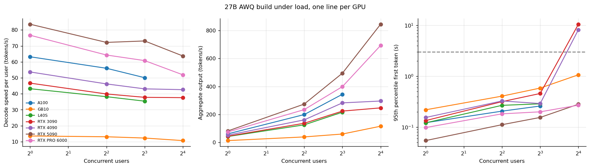
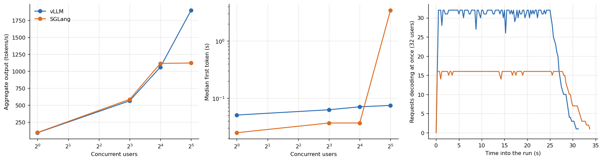
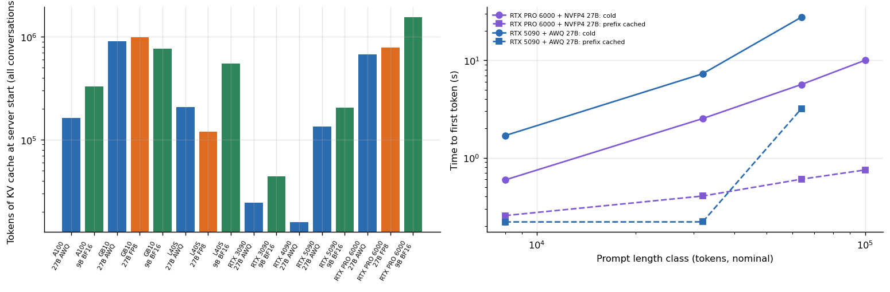

# LLM serving engines under load

**vLLM, SGLang and llama.cpp measured the way a service would use them: many users at once, long prompts, a cache that fills up, and a server that sometimes does not start.** Closed-loop load tests of a 27B model (4-bit AWQ, FP8, NVFP4, BF16 with and without speculative decoding) and a 9B model on 8 GPU models, plus an engine comparison on one RTX 5090, a 35-minute stability test and a long-context study.



## Why this matters

A single-user "tokens per second" figure says almost nothing about what a language model server will do under traffic. Three things decide it, and this repository measures all three:

1. **Concurrency.** Decode speed per user falls as the batch grows, aggregate throughput rises, and at some point the first token starts to wait in a queue. The knee is different on every card.
2. **Memory, not arithmetic.** On a 24 GB card the 4-bit 27B weights take 17.8 GiB and leave about 16,384 tokens of KV cache, shared by every conversation. The 9B model holds 43,194 tokens in the same memory because its cache costs 0.044 MiB per token against 0.104.
3. **Configuration.** Two engines with the same speed can behave very differently at 32 users because of a batch limit nobody reported.

## Headline results

| Question | Answer (from `data/`) |
|---|---|
| Cheapest card meeting 20 tok/s per user and a 3 s first token, 27B AWQ | **RTX 5090**, US$ 0.22 per million output tokens (the dearest was L40S at US$ 1.03) |
| Peak aggregate output, 27B AWQ | RTX 5090 844 tok/s, RTX PRO 6000 693, RTX 4090 296, RTX 3090 257 |
| vLLM against SGLang at 32 users (9B BF16, RTX 5090) | vLLM 1,900 tok/s with a 0.07 s median first token; SGLang 1,121 tok/s with 3.47 s |
| Why | Reconstructing concurrency from request timestamps: vLLM ran up to 32 requests at once, SGLang never more than 16. A batch cap, not an engine limit |
| Prefix cache on a long prompt | up to 33 times faster first token when the prefix is cached |
| Server starts that failed | 24 of 69, 20 of them with an out-of-memory error in the log (see below) |



The third panel is the evidence: both engines were asked for 32 simultaneous users, but SGLang kept half of them waiting. Up to 16 users the two engines tie within the noise of the test (`results/tables/engine_throughput_bootstrap.md` has bootstrap intervals), so the useful lesson is how to *detect* the difference: report the concurrency the server achieved, not the one the client requested.

## Memory decides which model starts



`analysis/cache_and_context.py` parses every vLLM start in the campaign (`data/vllm_starts_all.csv`; key log lines in `logs/vllm_start/`). The pattern is simple: a card whose memory cannot hold weights plus a positive KV budget fails at start (`results/tables/failed_starts_by_gpu.md`), whatever its architecture. The 32 GB RTX 5090 reports a *negative* cache budget for the 28 GiB FP8 and NVFP4 builds; the 24 GB cards fail before the weights finish loading.

## Repository map

```
src/llmbench/        load generator (llm_bench.py), long-context study (longctx.py), server launcher (serve27.sh)
analysis/            scaling.py, engines.py, cache_and_context.py (+ benchkit.py statistics)
data/                curated CSVs from the campaign
results/figures/     the figures above;  results/tables/  every table as CSV and Markdown
logs/vllm_start/     key lines of each vLLM server start, one file per start
tests/               checks that the published conclusions still follow from the data
```

## Reproduce

```bash
make setup && make all          # figures, tables, tests
python src/llmbench/llm_bench.py --base http://127.0.0.1:18000/v1 --model <name> --key <key> --out out --levels 1,4,8,16 --dur 60
```

The load generator is closed loop: each simulated user sends the next request as soon as the previous one finishes, with a mix of chat, code, structured JSON and (15% of requests) a long document. It needs a running OpenAI-compatible server.

## Limits

One run per cell in most places; repeated runs of the same cell on different rented hosts agreed within a few percent at low load and much less at the cache limit (one 3090 session at 8 users ran at half the speed of the other two, probably because of a different context and memory setting). The SGLang result is for the configuration I used (CUDA graphs on, a default batch cap); a differently tuned SGLang would behave differently. Quality of the outputs is not evaluated here, see the quantization repository.

## Articles that use this repository

- [vLLM against SGLang on one RTX 5090](https://www.kaggle.com/code/lucasrangelss/vllm-against-sglang-on-one-rtx-5090)
- [Cost per token and cost per user for a 27B model](https://www.kaggle.com/code/lucasrangelss/cost-per-token-and-cost-per-user-for-a-27b-model)
- [A 35-minute soak test on one RTX 5090](https://www.kaggle.com/code/lucasrangelss/a-35-minute-soak-test-on-one-rtx-5090)
- [Long context and prefix caching for agents](https://www.kaggle.com/code/lucasrangelss/long-context-and-prefix-caching-for-agents)
- [A 27B model on a 24 GB card in three ways](https://www.kaggle.com/code/lucasrangelss/a-27b-model-on-a-24-gb-card-in-three-ways)
- [NVFP4 on cards without FP4 hardware](https://www.kaggle.com/code/lucasrangelss/nvfp4-on-cards-without-fp4-hardware)
- Data: [Kaggle dataset](https://www.kaggle.com/datasets/lucasrangelss/gpu-ai-benchmark-campaign-2026). Orchestration and cost: [vast-gpu-benchmark-harness](https://github.com/LucasRangelSSouza/vast-gpu-benchmark-harness)

Licence: MIT for this code; see `LICENSE_NOTES.md` for tools and weights.
